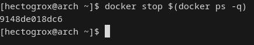
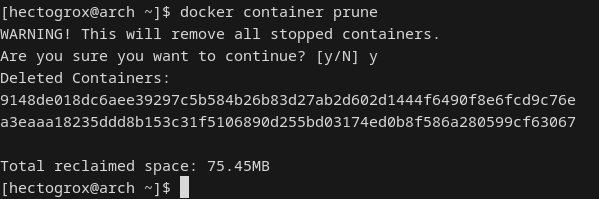
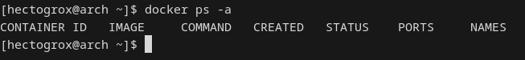
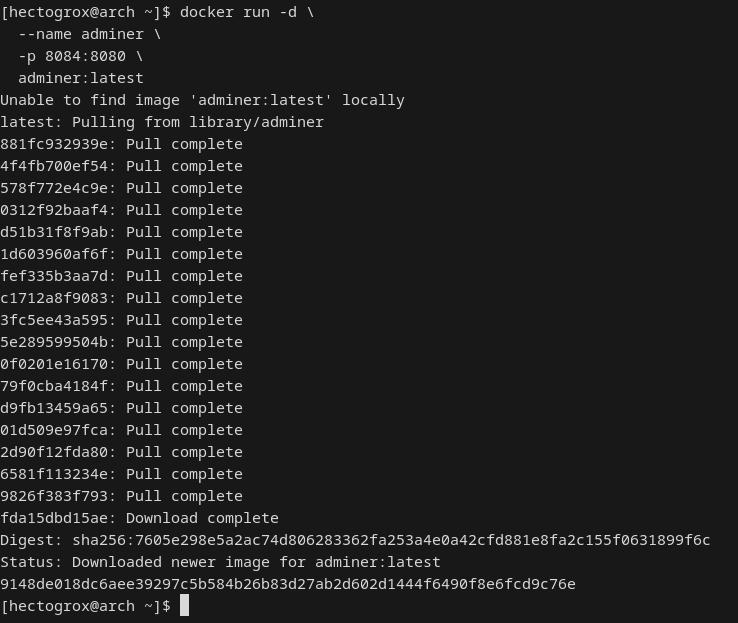
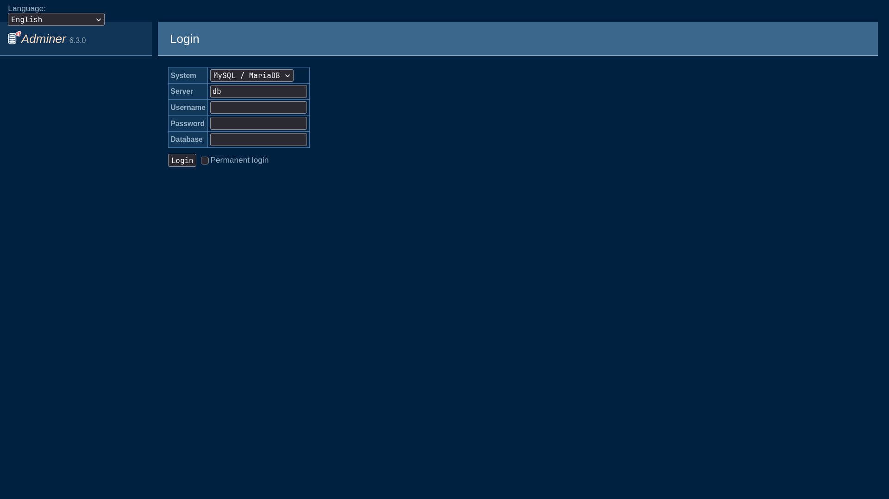

По необходимости сносим старые контейнеры 
### Останавливаем контейнеры
```
docker stop $(docker ps -q)
```


И удалаем их
```
docker container prune
```



### Устанавливаем adminer
```
docker run -d \
  --name adminer \
  -p 8084:8080 \
  adminer:latest
```



Можно посмотреть работу по https://localhost:8084/
