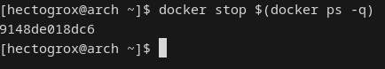
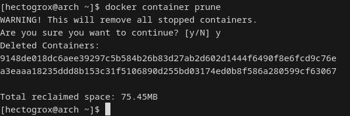
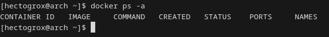
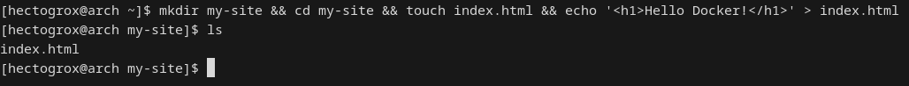
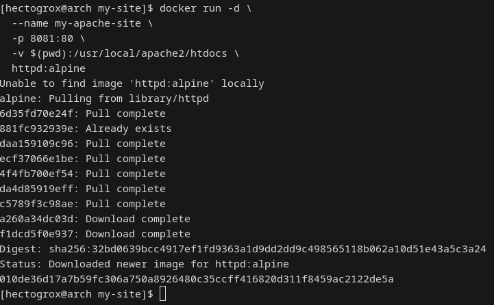
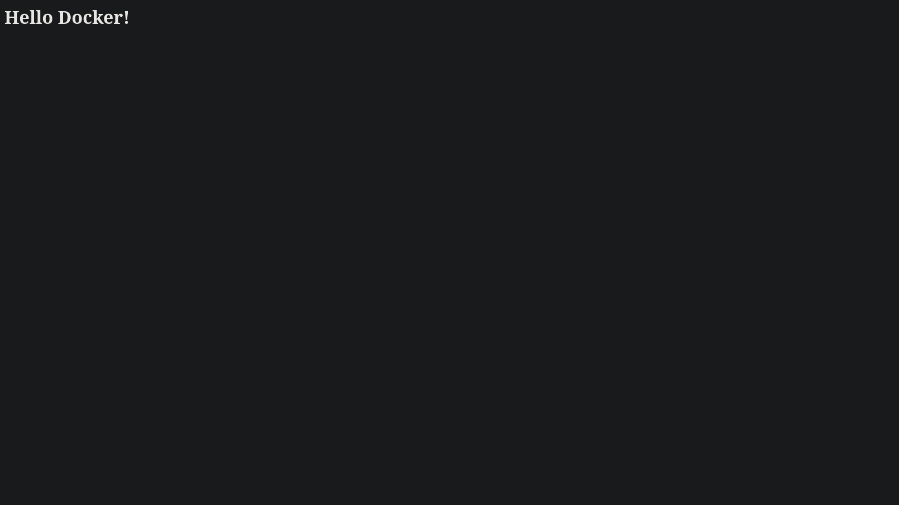

Для удобства сносим старые контейнеры

### Останавливаем контейнеры

```
docker stop $(docker ps -q)
```


И удалаем их

```
docker container prune
```
 


### Создание контейнера

Создаем структуру статичного сайта и делаем простой index.html
```
mkdir my-site && cd my-site && touch index.html && echo '<h1>Hello Docker!</h1>' > index.html
```


В нутри дериктории запускаем установку и запуск apache
```
docker run -d \
  --name my-apache-site \
  -p 8081:80 \
  -v $(pwd):/usr/local/apache2/htdocs \
  httpd:alpine
```


Проверяем результат по http://localhost:8081/

