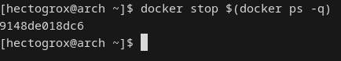
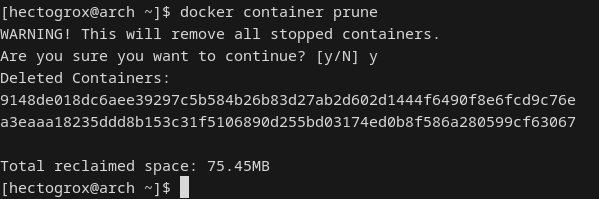
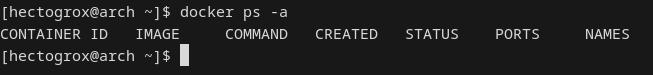

### Останавливаем все контейнеры 

```
docker stop $(docker ps -q)
```


И удалаем их

```
docker container prune
```



### Создаем контейнер

Создаем файл и рабочую дерикторию
```
mkdir HTTPserver && cd HTTPserver && touch test.txt && echo "Hello from HTTP server" > test.txt
```


Запускаем контейнер в дериктории
```
docker run -d \
  --name http-server \
  -p 8082:80 \
  -v $(pwd):/usr/share/nginx/html \
  nginx:alpine
```


Результат можно проверить по http://localhos8082/text.txt

