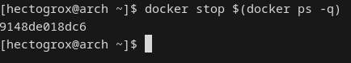
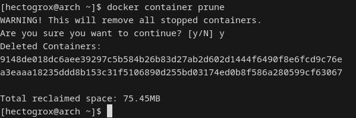
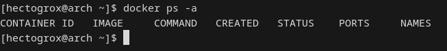
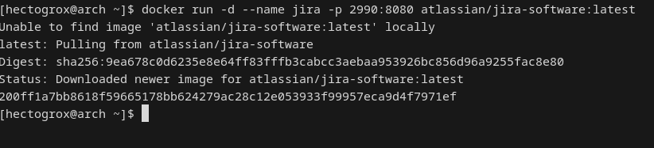
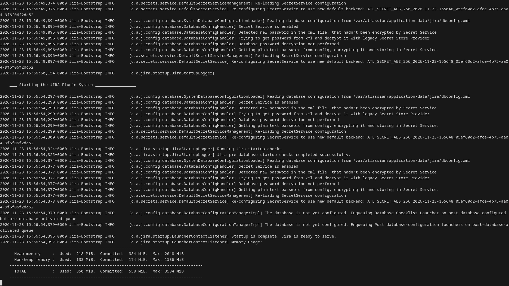
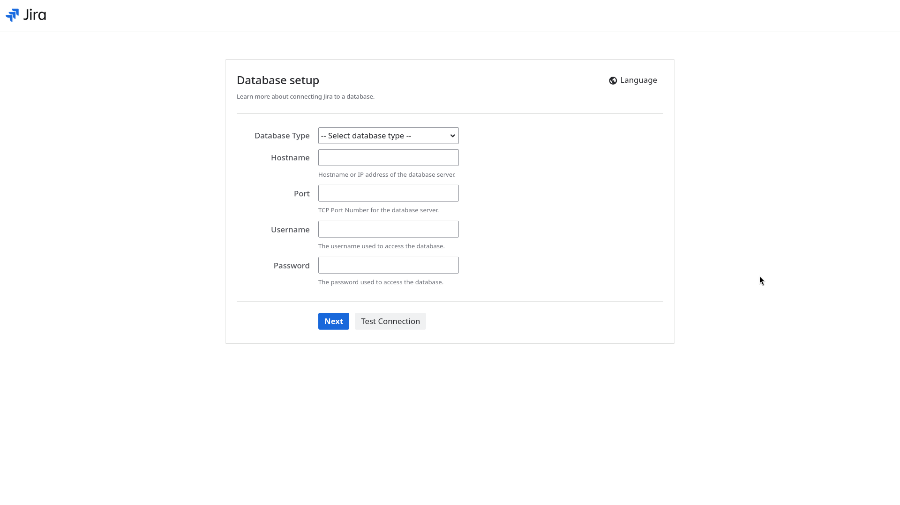

### Останавливаем контейнеры

```
docker stop $(docker ps -q)
```


И удалаем их

```
docker container prune
```
 


### Создаем и запускаем контейнер

```
docker run -d --name jira -p 2990:8080 atlassian/jira-software:latest
```


Во время установки можно запустить просмотр логов чтобы проверить идет ли процесс (у меня установка заняла 1 минуту)
```
docker logs -f jira
```


Jira готов к работе

Проверяем результат по http://localost:2990

