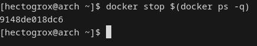
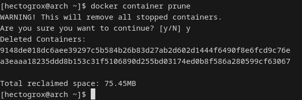
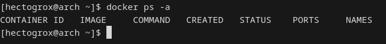
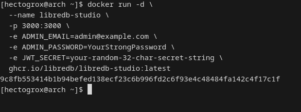
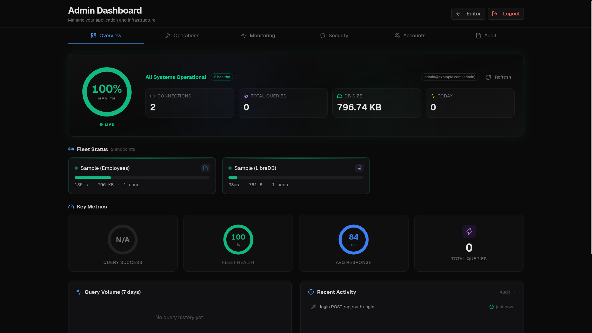
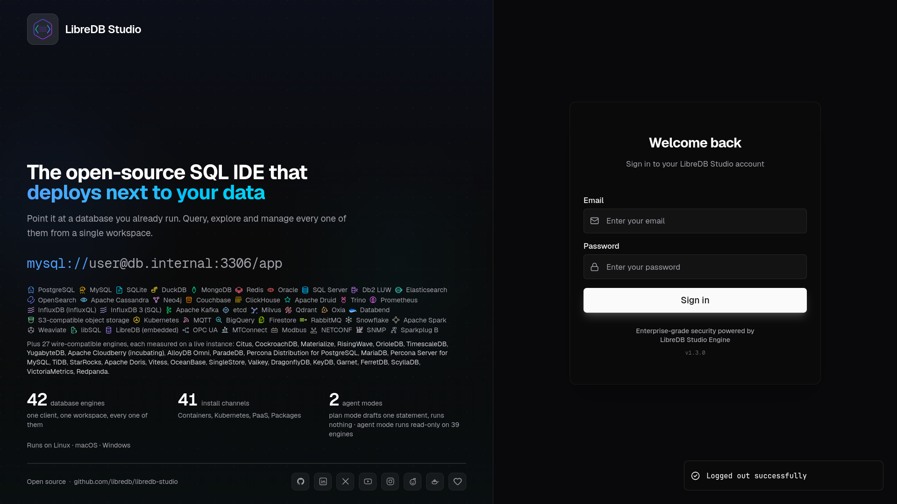

### Останавливаем контейнеры

```
docker stop $(docker ps -q)
```


И удалаем их

```
docker container prune
```
 


### Создание контейнера

При запуске контейнера можно сразу задать пароль и email
```
docker run -d \
  --name libredb-studio \
  -p 3000:3000 \
  -e ADMIN_EMAIL=admin@example.com \
  -e ADMIN_PASSWORD=YourStrongPassword \
  -e JWT_SECRET=your-random-32-char-secret-string \
  ghcr.io/libredb/libredb-studio:latest
```


Работу можно проверить по http://localhost:3000

